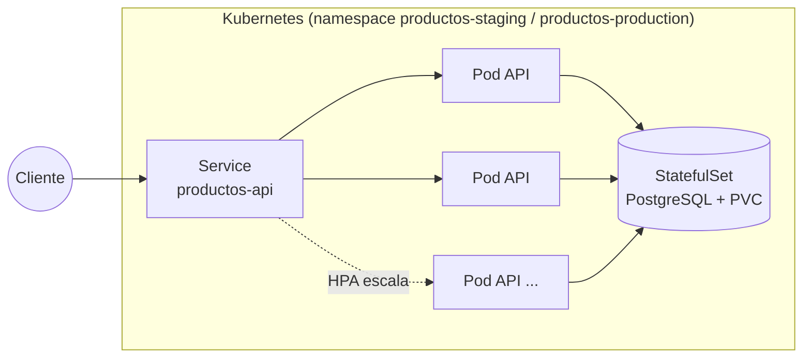
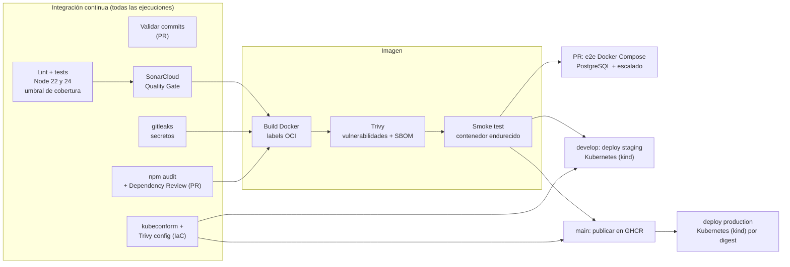
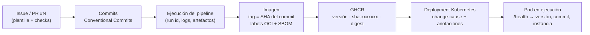
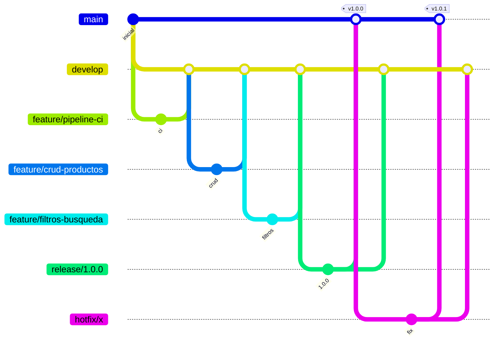

# productos-service

[](https://github.com/BenjaminStavrakopulos/devops-ep1-microservicio/actions/workflows/ci.yml)
[](https://sonarcloud.io/summary/new_code?id=BenjaminStavrakopulos_devops-ep1-microservicio)
[](https://sonarcloud.io/summary/new_code?id=BenjaminStavrakopulos_devops-ep1-microservicio)

Microservicio REST para la gestión de un catálogo de productos (**Node.js + Express + PostgreSQL**), contenerizado con **Docker**, orquestado con **Kubernetes** y **Docker Compose**, y con un pipeline **CI/CD en GitHub Actions** que automatiza todo su ciclo de vida: pruebas, análisis de seguridad, construcción de la imagen y despliegue.

> **Ingeniería DevOps (DOY0101)** – Trabajo realizado de forma **individual** por Benjamín Stavrakopulos.
> - **EP1** *Tu primer pipeline de despliegue*: estrategia de ramificación, convenciones y primer pipeline ([ver sección](#evaluación-parcial-1-control-de-versiones-y-colaboración)).
> - **EP2** *Añadiéndole complejidad a nuestro pipeline*: contenedores, pruebas, seguridad, despliegue automático y orquestación (secciones siguientes).

## Contenido

- [Arquitectura](#arquitectura)
- [Ejecución local](#ejecución-local)
- [Pipeline CI/CD](#pipeline-cicd)
- [Contenedores](#contenedores)
- [Orquestación](#orquestación)
- [Seguridad y escalabilidad](#seguridad-y-escalabilidad)
- [Cómo se garantiza la calidad](#cómo-se-garantiza-la-calidad)
- [Cómo se garantiza la trazabilidad](#cómo-se-garantiza-la-trazabilidad)
- [Evidencias](#evidencias)
- [Decisiones técnicas](#decisiones-técnicas)
- [API](#api)
- [Evaluación Parcial 1: control de versiones y colaboración](#evaluación-parcial-1-control-de-versiones-y-colaboración)
- [Documentación](#documentación)
- [Declaración de uso de IA](#declaración-de-uso-de-inteligencia-artificial)
- [Conclusiones y reflexión personal](#conclusiones-y-reflexión-personal)

## Arquitectura



- **API sin estado**: todas las réplicas comparten el estado en PostgreSQL, por eso pueden escalar horizontalmente.
- **Repositorio intercambiable**: con `DATABASE_URL` se usa PostgreSQL; sin ella, un repositorio en memoria (desarrollo y pruebas).
- **Endpoints de operación**: `/health` (*liveness*) y `/ready` (*readiness*), más apagado ordenado ante `SIGTERM`, para que el orquestador gestione los pods sin cortar peticiones.

## Ejecución local

**Requisitos:** Node.js 22+ (o Docker).

```bash
git clone https://github.com/BenjaminStavrakopulos/devops-ep1-microservicio.git
cd devops-ep1-microservicio

# Con Node (repositorio en memoria)
npm ci
npm start                 # http://localhost:3000
npm test                  # pruebas unitarias e integración
npm run test:ci           # pruebas + umbral de cobertura + reportes
npm run lint              # análisis estático

# Stack completo con Docker Compose (lb + api x3 + PostgreSQL)
cp .env.example .env      # definir POSTGRES_PASSWORD
docker compose up -d --build --wait
bash scripts/smoke-test.sh
docker compose up -d --scale api=5 --no-recreate   # escalar
docker compose down -v
```

Para Kubernetes local con [kind](https://kind.sigs.k8s.io/), ver [docs/ORQUESTACION.md](docs/ORQUESTACION.md#ejecutar-en-local).

## Pipeline CI/CD

Archivo: [`.github/workflows/ci.yml`](.github/workflows/ci.yml). Se ejecuta en cada **pull request** hacia `develop` o `main`, en cada **push** a `develop` y `main`, y de forma manual (`workflow_dispatch`).



| # | Job | Cuándo | Qué hace | Si falla |
|---|-----|--------|----------|----------|
| 1 | Validar convención de commits | PR | Verifica Conventional Commits en todos los commits del PR | Bloquea el PR |
| 2 | Lint y tests (Node 22 y 24) | Siempre | ESLint + **93 pruebas** unitarias e integración, con **umbral de cobertura** obligatorio | Bloquea |
| 3 | Análisis de código (SonarCloud) | Siempre | Bugs, vulnerabilidades, *security hotspots*, *code smells*, duplicación y cobertura; espera el **Quality Gate** | Bloquea |
| 4 | Escaneo de secretos (gitleaks) | Siempre | Busca credenciales en todo el historial | Bloquea |
| 5 | Auditoría de dependencias | Siempre | `npm audit --audit-level=high` y verificación de firmas | Bloquea |
| 6 | Revisión de dependencias del PR | PR | Detecta dependencias nuevas con vulnerabilidades *high* y comenta en el PR | Bloquea el PR |
| 7 | Validación de manifiestos e IaC | Siempre | `kustomize build`, `kubeconform -strict` y `trivy config` sobre Kubernetes y Dockerfile | Bloquea |
| 8 | Build de imagen Docker y smoke test | Siempre (si 2–5 pasan) | Build con labels OCI, **Trivy** (SARIF a *Security*, bloqueo HIGH/CRITICAL), **SBOM**, contenedor endurecido y pruebas de humo | Bloquea el despliegue |
| 9 | Prueba e2e de la orquestación | PR | Stack Docker Compose (Nginx + API x3 + PostgreSQL), pruebas de humo, escalado a 5 réplicas | Bloquea el PR |
| 10 | Deploy a staging (Kubernetes) | Push a `develop` o manual | Clúster kind de 3 nodos, rollout, smoke test, **rollback automático**, pruebas de balanceo, rolling update sin caída y HPA | Rollback |
| 11 | Publicar imagen en GHCR | Push a `main` | Publica **la misma imagen probada** (sin reconstruirla) con tags versión, `sha-*` y `latest` | — |
| 12 | Deploy a production (Kubernetes) | Tras 11 | Igual que staging, descargando la imagen desde GHCR **por digest** | Rollback |
| 13 | Alerta de seguridad | Si falla 3, 4, 5, 7 u 8 en `develop`/`main` | Abre o actualiza un **issue** con la etiqueta `seguridad` | — |

Además, **Dependabot** revisa cada semana las dependencias npm, las GitHub Actions y la imagen base de Docker, y abre PRs hacia `develop`. Las alertas de seguridad de Dependabot, el *secret scanning* y la *push protection* de GitHub están activados.

Detalle de cada etapa y su rol en CI/CD: [docs/CI-CD.md](docs/CI-CD.md).

### Flujo por rama y entorno

| Evento | Entorno | Qué se despliega |
|--------|---------|------------------|
| PR hacia `develop`/`main` | Runner efímero | Stack Docker Compose para la prueba e2e (no persiste) |
| Push a `develop` | **staging**: Kubernetes, namespace `productos-staging` | Imagen recién construida (tag = commit) |
| Push a `main` | **production**: Kubernetes, namespace `productos-production` | Imagen publicada en GHCR, referenciada por digest |

Los clústeres son **kind** (Kubernetes en Docker) creados dentro del runner de GitHub Actions: un entorno cloud simulado, efímero y reproducible. Los despliegues quedan registrados en los *environments* `staging` y `production` del repositorio.

## Contenedores

[`Dockerfile`](Dockerfile) multi-etapa sobre `node:22-alpine`:

| Práctica | Para qué |
|----------|----------|
| Multi-etapa (`deps` → `runtime`) con `npm ci --omit=dev --ignore-scripts` | Solo dependencias de producción, sin ejecutar scripts de terceros |
| Caché de npm con BuildKit (`--mount=type=cache`) | Builds más rápidos |
| Se eliminan npm, yarn y corepack de la imagen final; `apk upgrade` | Menos tamaño, menos superficie de ataque y menos CVE |
| Usuario sin privilegios (`USER node`); código como propiedad de root | Un atacante no puede modificar la aplicación |
| `HEALTHCHECK`, `STOPSIGNAL SIGTERM` y apagado ordenado en la app | El runtime sabe si el contenedor está sano y lo detiene sin cortar peticiones |
| Labels OCI `version`, `revision` (commit), `created`, `source` | Trazabilidad: cada imagen indica de qué commit viene |
| `.dockerignore` estricto | Contexto de build mínimo; tests, docs y `.env` no entran a la imagen |

En ejecución, los contenedores corren con **sistema de archivos de solo lectura**, sin *capabilities* de Linux (`drop: ALL`), sin escalada de privilegios, con perfil *seccomp* y con **límites de CPU y memoria**, tanto en Compose como en Kubernetes.

## Orquestación

Dos niveles, cada uno con su propósito (detalle en [docs/ORQUESTACION.md](docs/ORQUESTACION.md)):

### Kubernetes: staging y production

Manifiestos en [`k8s/`](k8s) con **Kustomize** (`base/` + `overlays/staging` y `overlays/production`):

| Recurso | Configuración |
|---------|---------------|
| `Deployment` productos-api | Rolling update `maxSurge: 1`, `maxUnavailable: 0`; probes *startup*, *liveness* (`/health`) y *readiness* (`/ready`); `preStop`; réplicas repartidas entre nodos (`topologySpreadConstraints`) |
| `HorizontalPodAutoscaler` | Escala por CPU (objetivo 70%): **2–4** réplicas en staging y **3–8** en production; subida rápida y bajada estabilizada (120 s) |
| `PodDisruptionBudget` | Mínimo 1 (staging) o 2 (production) réplicas disponibles durante mantenimientos |
| `StatefulSet` PostgreSQL | Volumen persistente (`volumeClaimTemplates`), probes `pg_isready` |
| `NetworkPolicy` | Bloquea todo el ingreso por defecto; solo la API puede conectarse a PostgreSQL |
| `Namespace` | *Pod Security Standards* en modo **restricted** (rechaza pods inseguros) |
| `Secret` | Lo crea el pipeline con una contraseña aleatoria; **no está en el repositorio** |

### Docker Compose: desarrollo local y prueba e2e de cada PR

[`docker-compose.yml`](docker-compose.yml): **Nginx** (balanceador) → **API x3** (escalable con `--scale`) → **PostgreSQL**, con healthchecks, `depends_on: service_healthy`, red de base de datos interna, límites de recursos y contenedores endurecidos.

## Seguridad y escalabilidad

**Parámetros de seguridad ajustados en el pipeline:**

| Capa | Control | Respuesta |
|------|---------|-----------|
| Código | SonarCloud (Quality Gate) | Bloqueo |
| Secretos | gitleaks en CI + secret scanning y push protection de GitHub | Bloqueo |
| Dependencias | Dependabot (alertas + PRs), `npm audit` (*high*), Dependency Review | Alerta + bloqueo |
| Imagen | Trivy: HIGH/CRITICAL con parche disponible; resultados en *Security → Code scanning*; SBOM | Alerta + bloqueo |
| Infraestructura como código | `trivy config` + `kubeconform` sobre manifiestos y Dockerfile | Bloqueo |
| Pipeline | `permissions` mínimos por job, `GITHUB_TOKEN` efímero, versiones de herramientas fijadas | — |
| Despliegue | Credenciales de BD aleatorias por despliegue, Pod Security *restricted*, NetworkPolicy | — |
| Ramas | Protección de `main`/`develop`: 9 checks obligatorios | Bloqueo del merge |
| Cualquier fallo en `develop`/`main` | Job *Alerta de seguridad* | Issue `seguridad` |

La prueba de que los bloqueos funcionan está en el [PR #19](https://github.com/BenjaminStavrakopulos/devops-ep1-microservicio/pull/19): agregaba `lodash@4.17.20` (CVE-2021-23337, severidad alta), la auditoría y la revisión de dependencias fallaron, no se construyó ni desplegó la imagen y el PR quedó **BLOCKED**. Política completa en [SECURITY.md](SECURITY.md).

**Parámetros de escalabilidad y desempeño:**

| Parámetro | Valor | Dónde |
|-----------|-------|-------|
| Réplicas mínimas / máximas (HPA) | 2–4 staging · 3–8 production | `k8s/overlays/*` |
| Objetivo de CPU del HPA | 70% de `requests.cpu` | `k8s/base/api-hpa.yaml` |
| Requests / limits API | 100m–500m CPU, 96–256 MiB (staging) · 200m–1 CPU, 128–384 MiB (production) | Deployment |
| Conexiones a BD por réplica | 5 (`DB_POOL_MAX`) | ConfigMap |
| Estrategia de actualización | `maxSurge 1` / `maxUnavailable 0` | Deployment |
| Disponibilidad durante mantenimientos | PDB `minAvailable` 1 / 2 | `api-pdb.yaml` |
| Réplicas en Compose | 3 (escalable a N con `--scale`) | `docker-compose.yml` |
| Tamaño máximo de petición | 10 KB (API), 16 KB (Nginx) | `app.js`, `nginx.conf` |

## Cómo se garantiza la calidad

1. **Política de pruebas obligatoria.** 93 pruebas con el test runner nativo de Node:
   - **Unitarias** (`tests/unit/`): validación (valores límite, tipos inválidos), filtros y ordenamiento, repositorio en memoria, repositorio PostgreSQL (contra una base emulada con `pg-mem`) y reintentos.
   - **Integración** (`tests/integration/`): toda la API por HTTP, readiness, apagado, cabeceras de seguridad, límite de tamaño y errores 500 sin filtrar detalles.
   - **Casos críticos**, incluida la regresión del hotfix v1.0.1 (eliminar un id inexistente borraba datos).
   - **Umbral de cobertura** que bloquea el pipeline: **≥90% de líneas, ≥85% de ramas, ≥90% de funciones** (actual: ~98.8% de líneas, ~98% de ramas).
   - Se ejecutan en **Node 22 y 24**; los reportes JUnit y LCOV quedan como artefactos.
2. **Análisis estático.** ESLint (0 errores) y **SonarCloud con Quality Gate**.
3. **Pruebas del artefacto real.** La imagen se prueba como contenedor endurecido; el stack completo con PostgreSQL real se prueba en cada PR (e2e Compose); en Kubernetes se verifican el balanceo, un **rolling update con tráfico continuo y 0 peticiones fallidas**, y el autoescalado.
4. **Despliegue seguro.** Rollout verificado, pruebas de humo después de cada despliegue y **rollback automático** si fallan.
5. **Revisión.** Ningún cambio llega a `develop` o `main` sin un PR con todos los checks en verde (protección de ramas) y la plantilla de PR completa.
6. **Convenciones automatizadas.** Conventional Commits validado en el CI y ramas con naming GitFlow ([guía](docs/GUIA-BUENAS-PRACTICAS.md)).

## Cómo se garantiza la trazabilidad

Cada cambio se puede seguir **desde el commit hasta el pod que lo ejecuta**, y en sentido inverso:



| Pregunta | Dónde se responde |
|----------|-------------------|
| ¿Qué PR introdujo este cambio? | `git log --merges`, mensaje `Merge pull request #N`; `gh pr view N` |
| ¿Qué commit y versión están corriendo? | `GET /health` → `version`, `commit`, `instancia` |
| ¿De qué commit viene esta imagen? | Tag `sha-xxxxxxx` en GHCR y label `org.opencontainers.image.revision` |
| ¿Qué componentes contiene la imagen? | Artefacto **SBOM** (CycloneDX) de la ejecución |
| ¿Qué se desplegó, cuándo y desde qué pipeline? | `kubectl rollout history` (`change-cause` con el commit), anotaciones `productos.devops/commit` y `productos.devops/pipeline`, artefacto `manifiesto-<entorno>.yaml` y la pestaña *Deployments* de GitHub |
| ¿Qué cambió entre versiones? | Tags `vX.Y.Z`, [GitHub Releases](https://github.com/BenjaminStavrakopulos/devops-ep1-microservicio/releases) y [CHANGELOG](CHANGELOG.md) |
| ¿Qué controles pasó un cambio? | Checks del PR y *Job Summary* de cada ejecución (pruebas, cobertura, imagen, estado del clúster) |

El registro paso a paso del flujo de trabajo está en [docs/TRAZABILIDAD.md](docs/TRAZABILIDAD.md).

## Evidencias

> Esta sección se completa con los enlaces de la release que integra la EP2.

## Decisiones técnicas

> ✍️ **Sección pendiente: la redacta el estudiante.** La pauta prohíbe usar IA para las justificaciones técnicas.
>
> Preguntas guía:
> - ¿Por qué **Kubernetes** para staging y production, y **Docker Compose** para local y PRs? ¿Qué aporta cada uno?
> - ¿Por qué **SonarCloud** y no Snyk? ¿Qué cubre cada herramienta de seguridad (SonarCloud, Trivy, npm audit, Dependabot, gitleaks) que las otras no?
> - ¿Por qué **bloquear** en severidad *high* y no en *medium*? ¿Qué riesgo aceptas?
> - ¿Por qué fue necesario agregar **PostgreSQL** para poder escalar? ¿Qué pasaría con varias réplicas y datos en memoria?
> - ¿Por qué esos valores de **HPA** (objetivo 70%, mínimos y máximos) y de **requests/limits**?
> - ¿Por qué un **umbral de cobertura** de 90/85/90?
> - ¿Por qué publicar en GHCR **la misma imagen probada** y desplegar por **digest**?

## API

Variables de entorno:

| Variable | Por defecto | Descripción |
|----------|-------------|-------------|
| `PORT` | `3000` | Puerto HTTP |
| `DATABASE_URL` | *(vacía → memoria)* | Cadena de conexión a PostgreSQL |
| `DB_POOL_MAX` | `10` | Conexiones máximas por réplica |
| `SHUTDOWN_TIMEOUT_MS` | `10000` | Tiempo máximo del apagado ordenado |
| `GIT_SHA` | `local` | Commit desplegado (lo inyecta el pipeline en la imagen) |

| Método | Ruta                  | Descripción                     |
|--------|-----------------------|---------------------------------|
| GET    | `/health`             | *Liveness*: estado, versión, commit, instancia y tipo de almacenamiento |
| GET    | `/ready`              | *Readiness*: `200` si puede recibir tráfico, `503` si la base de datos no responde o se está apagando |
| GET    | `/api/productos`      | Lista productos (con filtros)   |
| GET    | `/api/productos/:id`  | Obtiene un producto por id      |
| POST   | `/api/productos`      | Crea un producto                |
| PUT    | `/api/productos/:id`  | Reemplaza un producto           |
| PATCH  | `/api/productos/:id`  | Actualiza campos de un producto |
| DELETE | `/api/productos/:id`  | Elimina un producto             |

Ejemplo de producto:

```json
{ "id": 1, "nombre": "Teclado mecánico", "categoria": "perifericos", "precio": 45990, "stock": 12 }
```

`GET /api/productos` acepta los siguientes filtros opcionales (combinables):

| Parámetro   | Ejemplo            | Descripción                                   |
|-------------|--------------------|-----------------------------------------------|
| `categoria` | `?categoria=audio` | Filtra por categoría (sin distinguir mayúsculas) |
| `q`         | `?q=teclado`       | Busca el texto dentro del nombre              |
| `precioMin` | `?precioMin=10000` | Precio mínimo                                 |
| `precioMax` | `?precioMax=50000` | Precio máximo                                 |
| `ordenar`   | `?ordenar=-precio` | Ordena por `nombre`, `precio` o `stock` (prefijo `-` = descendente) |

---

## Evaluación Parcial 1: control de versiones y colaboración

### Estrategia de ramificación

#### Modelos de ramificación evaluados

| Modelo | Ramas | Cómo funciona | Ventajas en equipos cloud | Desventajas | Contexto ideal |
|--------|-------|---------------|---------------------------|-------------|----------------|
| **GitFlow** | `main`, `develop`, `feature/*`, `release/*`, `hotfix/*` | Las funcionalidades se integran en `develop`; las versiones se estabilizan en `release/*` y llegan a `main` etiquetadas; los errores urgentes de producción se corrigen en `hotfix/*`. | Separa claramente producción, integración y desarrollo; permite tener un entorno *staging* (`develop`) y otro *production* (`main`); soporta versiones numeradas y parches sin arrastrar trabajo incompleto. | Más ramas y merges; las ramas largas pueden generar conflictos; el ciclo de entrega es más lento. | Productos con versiones planificadas, varios entornos o necesidad de mantener versiones en producción. |
| **GitHub Flow** | `main` + ramas de corta vida | Se crea una rama desde `main`, se abre un PR, se revisa, se mergea y se despliega de inmediato. | Muy simple; favorece despliegues frecuentes; encaja directo con PRs y GitHub Actions. | Un solo entorno de referencia; no hay un lugar natural para estabilizar una versión ni para hacer hotfixes de versiones antiguas. | Aplicaciones web/SaaS con despliegue continuo y equipos pequeños. |
| **GitLab Flow** | `main` + ramas de entorno (`staging`, `production`) o de versión | Como GitHub Flow, pero los cambios "fluyen" de `main` hacia ramas que representan entornos. | Mapea las ramas a los entornos cloud; es más simple que GitFlow. | Requiere disciplina para propagar los cambios en un solo sentido. | Equipos con entornos de despliegue fijos (dev → staging → prod). |
| **Trunk-based development** | `main` (trunk) + ramas de horas o 1–2 días | Todos integran en el trunk varias veces al día; lo incompleto se oculta con *feature flags*. | Integración realmente continua, casi sin conflictos de merge; es el modelo de los equipos DevOps de alto rendimiento. | Exige muy buena cobertura de pruebas, CI rápida, *feature flags* y madurez del equipo. | Equipos con CI/CD maduro que despliegan varias veces al día. |

#### Modelo elegido: GitFlow



| Rama | Rol | Entorno asociado en el pipeline |
|------|-----|---------------------------------|
| `main` | Producción, solo versiones etiquetadas | `production` → imagen en GHCR + Kubernetes |
| `develop` | Integración de la próxima versión | `staging` → Kubernetes |
| `feature/*` | Una funcionalidad por rama | CI + e2e Compose en el PR |
| `release/*` | Estabilizar y versionar | CI en el PR hacia `main` |
| `hotfix/*` | Corrección urgente de producción | CI en el PR hacia `main` |

#### Justificación de la elección

> ✍️ **Sección pendiente: la redacta el estudiante.** La pauta de la evaluación prohíbe usar IA para escribir justificaciones técnicas.
>
> La justificación tiene que **contrastar GitFlow con las alternativas** de la tabla anterior, no solo describirlo. Preguntas guía:
> - **Frente a GitHub Flow:** ¿qué te aporta tener `develop` + *staging* antes de producción, en vez de desplegar cada PR directo desde `main`?
> - **Frente a trunk-based:** ¿qué requisitos de trunk-based (feature flags, cobertura de tests, integrar varias veces al día) no se cumplen en este proyecto?
> - **Frente a GitLab Flow:** ¿por qué ramas por tipo de trabajo y no ramas por entorno?
> - **Evidencia propia:** ¿cómo te sirvieron `release/*` y el hotfix v1.0.1 (bug corregido en producción sin arrastrar trabajo de `develop`)?
> - **Límites:** ¿qué costo tiene GitFlow aquí y en qué escenario cambiarías de modelo?

### Control de versiones y releases

El proyecto usa **Versionado Semántico** (`MAJOR.MINOR.PATCH`). Cada integración a `main` se publica con un **tag anotado**, un **GitHub Release** y una entrada en el [CHANGELOG](CHANGELOG.md). La versión también aparece en `GET /health` y en la etiqueta de la imagen Docker.

| Versión | Tipo | Llegó a `main` por | Contenido |
|---------|------|--------------------|-----------|
| [v1.0.0](https://github.com/BenjaminStavrakopulos/devops-ep1-microservicio/releases/tag/v1.0.0) | MAJOR (primera versión estable) | `release/1.0.0` ([#5](https://github.com/BenjaminStavrakopulos/devops-ep1-microservicio/pull/5)) | CRUD, filtros, pipeline CI/CD, documentación |
| [v1.0.1](https://github.com/BenjaminStavrakopulos/devops-ep1-microservicio/releases/tag/v1.0.1) | PATCH | `hotfix/eliminar-producto-inexistente` ([#7](https://github.com/BenjaminStavrakopulos/devops-ep1-microservicio/pull/7)) | Corrección: `DELETE` de un id inexistente borraba el último producto |
| [v1.0.2](https://github.com/BenjaminStavrakopulos/devops-ep1-microservicio/releases/tag/v1.0.2) | PATCH | `release/1.0.2` ([#10](https://github.com/BenjaminStavrakopulos/devops-ep1-microservicio/pull/10)) | Documentación de trazabilidad |
| [v1.1.0](https://github.com/BenjaminStavrakopulos/devops-ep1-microservicio/releases/tag/v1.1.0) | MINOR | `release/1.1.0` ([#13](https://github.com/BenjaminStavrakopulos/devops-ep1-microservicio/pull/13)) | Escaneo de secretos en el pipeline y documentación de credenciales |

```bash
git tag -l -n1                     # tags con su mensaje
gh release list                    # releases publicados
git log v1.0.0..v1.0.1 --oneline   # qué cambió entre dos versiones
```

El proceso para crear una release está en la [guía de buenas prácticas](docs/GUIA-BUENAS-PRACTICAS.md#6-control-de-versiones-y-releases). Todas las ramas `release/*` y `hotfix/*` usadas se conservan en el repositorio como evidencia.

### Convenciones del repositorio

Resumen (el detalle está en la [guía de buenas prácticas](docs/GUIA-BUENAS-PRACTICAS.md)):

- **Ramas:** `<tipo>/<descripcion-en-kebab-case>`, por ejemplo `feature/filtros-busqueda` o `hotfix/eliminar-producto-inexistente`.
- **Commits:** [Conventional Commits](https://www.conventionalcommits.org/es/v1.0.0/), por ejemplo `feat(productos): agregar filtro por categoría`. El pipeline lo valida automáticamente.
- **Merge:** siempre por pull request con *merge commit*; `release/*` y `hotfix/*` se integran en `main` **y** en `develop`.
- **Revisión:** CI en verde + checklist de la plantilla de PR + 1 aprobación (en equipo).
- **Versionado:** SemVer, tags `vX.Y.Z`, GitHub Releases y [CHANGELOG.md](CHANGELOG.md).

---

## Documentación

| Documento | Contenido |
|-----------|-----------|
| [docs/CI-CD.md](docs/CI-CD.md) | Cada etapa del pipeline, su rol en CI/CD y manejo de credenciales |
| [docs/ORQUESTACION.md](docs/ORQUESTACION.md) | Kubernetes y Docker Compose: recursos, escalado, estabilidad y ejecución local |
| [docs/TRAZABILIDAD.md](docs/TRAZABILIDAD.md) | Registro del flujo GitFlow: comandos, PRs, tags y cómo rastrear cada cambio |
| [docs/GUIA-BUENAS-PRACTICAS.md](docs/GUIA-BUENAS-PRACTICAS.md) | Naming de ramas, commits, flujos de merge, revisión, versionado, estructura de carpetas |
| [SECURITY.md](SECURITY.md) | Política de seguridad y controles automáticos |
| [CONTRIBUTING.md](CONTRIBUTING.md) | Pasos rápidos para contribuir |

## Declaración de uso de Inteligencia Artificial

De acuerdo con las indicaciones de la evaluación y la [guía de citación de IA de Bibliotecas Duoc UC](https://bibliotecas.duoc.cl/ia):

| Evaluación | Herramienta | Uso |
|------------|-------------|-----|
| EP1 | Claude Code (Anthropic, modelo Claude Opus 5.5), octubre 2026 | Apoyo en la generación del código base del microservicio, la configuración del workflow de GitHub Actions, el Dockerfile y la redacción de la documentación técnica (guía de buenas prácticas, explicación del pipeline y descripción de los modelos de ramificación). |
| EP2 | Claude Code (Anthropic, modelo Claude Opus 5.5), octubre 2026 | Apoyo en la implementación de la persistencia con PostgreSQL, las pruebas unitarias, la optimización del Dockerfile, los manifiestos de Kubernetes y Docker Compose, la configuración de las etapas de seguridad (Dependabot, SonarCloud, Trivy, alertas) y despliegue del pipeline, y la redacción de la documentación técnica descriptiva (README, CI-CD, ORQUESTACION). |

Todo el contenido generado fue revisado y validado por el autor, y cada cambio se verificó con el pipeline. Las **justificaciones técnicas** (estrategia de ramificación y decisiones técnicas) y las **conclusiones y reflexiones personales** fueron redactadas por el autor sin apoyo de IA.

> Cita sugerida (formato APA): Anthropic. (2026). *Claude Code* (Claude Opus 5.5) [Modelo de lenguaje de gran tamaño]. https://claude.com/claude-code

## Conclusiones y reflexión personal

### EP1

> ✍️ **Sección pendiente: la redacta el estudiante sin apoyo de IA**, como exige la pauta.
>
> Incluir: qué aprendiste sobre control de versiones, GitFlow y CI/CD; qué dificultades tuviste; cuál fue tu contribución (trabajo individual).

### EP2

> ✍️ **Sección pendiente: la redacta el estudiante sin apoyo de IA**, como exige la pauta.
>
> Incluir: qué aprendiste sobre contenedores, pruebas automatizadas, seguridad en el pipeline, despliegue y orquestación; qué dificultades tuviste (por ejemplo, el estado en memoria con varias réplicas o el healthcheck IPv6 del balanceador); cuál fue tu contribución (trabajo individual).

## Autor

**Benjamín Stavrakopulos** – [@BenjaminStavrakopulos](https://github.com/BenjaminStavrakopulos)
