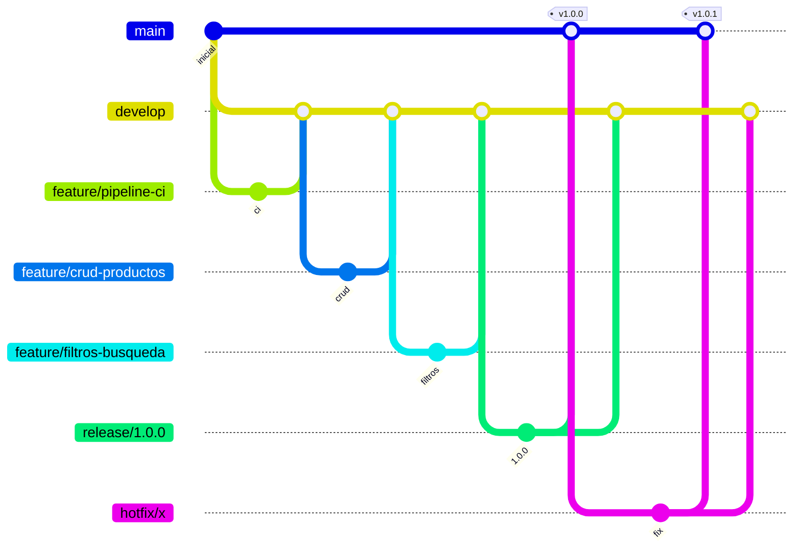

# productos-service

[](https://github.com/BenjaminStavrakopulos/devops-ep1-microservicio/actions/workflows/ci.yml)

Microservicio REST para la gestión de un catálogo de productos, construido con **Node.js + Express**, contenerizado con **Docker** y con un pipeline **CI/CD en GitHub Actions**.

> **Evaluación Parcial N°1 – Ingeniería DevOps (DOY0101)**
> Encargo: *Tu primer pipeline de despliegue*. Trabajo realizado de forma **individual** por Benjamín Stavrakopulos.

## Contenido

- [Ejecución local](#ejecución-local)
- [API](#api)
- [Estrategia de ramificación](#estrategia-de-ramificación)
- [Pipeline CI/CD](#pipeline-cicd)
- [Control de versiones y releases](#control-de-versiones-y-releases)
- [Convenciones del repositorio](#convenciones-del-repositorio)
- [Documentación](#documentación)
- [Declaración de uso de IA](#declaración-de-uso-de-inteligencia-artificial)
- [Conclusiones y reflexión personal](#conclusiones-y-reflexión-personal)

## Ejecución local

**Requisitos:** Node.js 22+ (o Docker).

```bash
git clone https://github.com/BenjaminStavrakopulos/devops-ep1-microservicio.git
cd devops-ep1-microservicio

# Con Node
npm ci
npm start                 # http://localhost:3000
npm test                  # pruebas automatizadas
npm run lint              # análisis estático

# Con Docker (entorno cloud simulado)
docker compose up -d --build --wait
bash scripts/smoke-test.sh
docker compose down
```

## API

El servicio usa **PostgreSQL** cuando se define la variable `DATABASE_URL` (Docker Compose, Kubernetes) y un **repositorio en memoria** cuando no (desarrollo local y pruebas). Con PostgreSQL todas las réplicas comparten el mismo estado, lo que permite escalar horizontalmente.

| Variable | Por defecto | Descripción |
|----------|-------------|-------------|
| `PORT` | `3000` | Puerto HTTP |
| `DATABASE_URL` | *(vacía → memoria)* | Cadena de conexión a PostgreSQL |
| `DB_POOL_MAX` | `10` | Conexiones máximas por réplica |
| `SHUTDOWN_TIMEOUT_MS` | `10000` | Tiempo máximo del apagado ordenado |
| `GIT_SHA` | `local` | Commit desplegado (lo inyecta el pipeline en la imagen) |

| Método | Ruta                  | Descripción                     |
|--------|-----------------------|---------------------------------|
| GET    | `/health`             | *Liveness*: estado, versión, commit y tipo de almacenamiento |
| GET    | `/ready`              | *Readiness*: `200` si puede recibir tráfico, `503` si la base de datos no responde o se está apagando |
| GET    | `/api/productos`      | Lista productos (con filtros)   |
| GET    | `/api/productos/:id`  | Obtiene un producto por id      |
| POST   | `/api/productos`      | Crea un producto                |
| PUT    | `/api/productos/:id`  | Reemplaza un producto           |
| PATCH  | `/api/productos/:id`  | Actualiza campos de un producto |
| DELETE | `/api/productos/:id`  | Elimina un producto             |

Ejemplo de producto:

```json
{ "id": 1, "nombre": "Teclado mecánico", "categoria": "perifericos", "precio": 45990, "stock": 12 }
```

### Filtros del listado

`GET /api/productos` acepta los siguientes parámetros opcionales (combinables):

| Parámetro   | Ejemplo            | Descripción                                   |
|-------------|--------------------|-----------------------------------------------|
| `categoria` | `?categoria=audio` | Filtra por categoría (sin distinguir mayúsculas) |
| `q`         | `?q=teclado`       | Busca el texto dentro del nombre              |
| `precioMin` | `?precioMin=10000` | Precio mínimo                                 |
| `precioMax` | `?precioMax=50000` | Precio máximo                                 |
| `ordenar`   | `?ordenar=-precio` | Ordena por `nombre`, `precio` o `stock` (prefijo `-` = descendente) |

## Estrategia de ramificación

### Modelos de ramificación evaluados

| Modelo | Ramas | Cómo funciona | Ventajas en equipos cloud | Desventajas | Contexto ideal |
|--------|-------|---------------|---------------------------|-------------|----------------|
| **GitFlow** | `main`, `develop`, `feature/*`, `release/*`, `hotfix/*` | Las funcionalidades se integran en `develop`; las versiones se estabilizan en `release/*` y llegan a `main` etiquetadas; los errores urgentes de producción se corrigen en `hotfix/*`. | Separa claramente producción, integración y desarrollo; permite tener un entorno *staging* (`develop`) y otro *production* (`main`); soporta versiones numeradas y parches sin arrastrar trabajo incompleto. | Más ramas y merges; las ramas largas pueden generar conflictos; el ciclo de entrega es más lento. | Productos con versiones planificadas, varios entornos o necesidad de mantener versiones en producción. |
| **GitHub Flow** | `main` + ramas de corta vida | Se crea una rama desde `main`, se abre un PR, se revisa, se mergea y se despliega de inmediato. | Muy simple; favorece despliegues frecuentes; encaja directo con PRs y GitHub Actions. | Un solo entorno de referencia; no hay un lugar natural para estabilizar una versión ni para hacer hotfixes de versiones antiguas. | Aplicaciones web/SaaS con despliegue continuo y equipos pequeños. |
| **GitLab Flow** | `main` + ramas de entorno (`staging`, `production`) o de versión | Como GitHub Flow, pero los cambios "fluyen" de `main` hacia ramas que representan entornos. | Mapea las ramas a los entornos cloud; es más simple que GitFlow. | Requiere disciplina para propagar los cambios en un solo sentido. | Equipos con entornos de despliegue fijos (dev → staging → prod). |
| **Trunk-based development** | `main` (trunk) + ramas de horas o 1–2 días | Todos integran en el trunk varias veces al día; lo incompleto se oculta con *feature flags*. | Integración realmente continua, casi sin conflictos de merge; es el modelo de los equipos DevOps de alto rendimiento. | Exige muy buena cobertura de pruebas, CI rápida, *feature flags* y madurez del equipo. | Equipos con CI/CD maduro que despliegan varias veces al día. |

### Modelo elegido: GitFlow



| Rama | Rol | Entorno asociado en el pipeline |
|------|-----|---------------------------------|
| `main` | Producción, solo versiones etiquetadas | `production` → imagen publicada en GHCR |
| `develop` | Integración de la próxima versión | `staging` → deploy simulado con Docker Compose |
| `feature/*` | Una funcionalidad por rama | CI en el PR (runner efímero) |
| `release/*` | Estabilizar y versionar | CI en el PR hacia `main` |
| `hotfix/*` | Corrección urgente de producción | CI en el PR hacia `main` |

### Justificación de la elección

> ✍️ **Sección pendiente: la redacta el estudiante.** La pauta de la evaluación prohíbe usar IA para escribir justificaciones técnicas.
>
> La justificación tiene que **contrastar GitFlow con las alternativas** de la tabla anterior, no solo describirlo. Preguntas guía:
> - **Frente a GitHub Flow:** ¿qué te aporta tener `develop` + *staging* antes de producción, en vez de desplegar cada PR directo desde `main`?
> - **Frente a trunk-based:** ¿qué requisitos de trunk-based (feature flags, cobertura de tests, integrar varias veces al día) no se cumplen en este proyecto?
> - **Frente a GitLab Flow:** ¿por qué ramas por tipo de trabajo y no ramas por entorno?
> - **Evidencia propia:** ¿cómo te sirvieron `release/*` y el hotfix v1.0.1 (bug corregido en producción sin arrastrar trabajo de `develop`)?
> - **Límites:** ¿qué costo tiene GitFlow aquí y en qué escenario cambiarías de modelo?

## Pipeline CI/CD

El workflow [`.github/workflows/ci.yml`](.github/workflows/ci.yml) se ejecuta **en cada push a `develop` y `main`, y en cada pull request hacia `main` o `develop`**:

| Job | Cuándo | Qué hace |
|-----|--------|----------|
| Validar convención de commits | PR | Verifica que todos los commits cumplan Conventional Commits |
| Escaneo de secretos (gitleaks) | Siempre | Revisa todo el historial buscando credenciales filtradas; si encuentra alguna, bloquea el build |
| Lint y tests (Node 22 y 24) | Siempre | `npm ci`, ESLint y pruebas con cobertura |
| Build de imagen Docker y smoke test | Siempre | Construye la imagen, la ejecuta y prueba los endpoints por HTTP |
| Deploy a staging | Push a `develop` | Despliega la imagen con Docker Compose en el runner (cloud simulado) y valida con pruebas de humo |
| Publicar imagen en GHCR | Push a `main` | Publica `ghcr.io/benjaminstavrakopulos/productos-service` con las etiquetas versión, `latest` y SHA |

La explicación detallada del rol de cada etapa dentro del proceso CI/CD está en [docs/CI-CD.md](docs/CI-CD.md).

### Credenciales y GitHub Secrets

El pipeline no tiene ninguna credencial escrita en el código. Para publicar en GHCR usa `secrets.GITHUB_TOKEN`, un token efímero que GitHub genera en cada ejecución, con permisos mínimos: `contents: read` global y `packages: write` solo en el job de publicación. Los despliegues usan los *environments* `staging` y `production`, que admiten secretos y reglas de aprobación propios. Más detalle en [docs/CI-CD.md](docs/CI-CD.md#manejo-de-credenciales-con-github-secrets).

## Control de versiones y releases

El proyecto usa **Versionado Semántico** (`MAJOR.MINOR.PATCH`). Cada integración a `main` se publica con un **tag anotado**, un **GitHub Release** y una entrada en el [CHANGELOG](CHANGELOG.md). La versión también aparece en `GET /health` y en la etiqueta de la imagen Docker.

| Versión | Tipo | Llegó a `main` por | Contenido |
|---------|------|--------------------|-----------|
| [v1.0.0](https://github.com/BenjaminStavrakopulos/devops-ep1-microservicio/releases/tag/v1.0.0) | MAJOR (primera versión estable) | `release/1.0.0` ([#5](https://github.com/BenjaminStavrakopulos/devops-ep1-microservicio/pull/5)) | CRUD, filtros, pipeline CI/CD, documentación |
| [v1.0.1](https://github.com/BenjaminStavrakopulos/devops-ep1-microservicio/releases/tag/v1.0.1) | PATCH | `hotfix/eliminar-producto-inexistente` ([#7](https://github.com/BenjaminStavrakopulos/devops-ep1-microservicio/pull/7)) | Corrección: `DELETE` de un id inexistente borraba el último producto |
| [v1.0.2](https://github.com/BenjaminStavrakopulos/devops-ep1-microservicio/releases/tag/v1.0.2) | PATCH | `release/1.0.2` ([#10](https://github.com/BenjaminStavrakopulos/devops-ep1-microservicio/pull/10)) | Documentación de trazabilidad |
| [v1.1.0](https://github.com/BenjaminStavrakopulos/devops-ep1-microservicio/releases/tag/v1.1.0) | MINOR | `release/1.1.0` ([#13](https://github.com/BenjaminStavrakopulos/devops-ep1-microservicio/pull/13)) | Escaneo de secretos en el pipeline y documentación de credenciales |

```bash
git tag -l -n1                 # tags con su mensaje
gh release list                # releases publicados
git log v1.0.0..v1.0.1 --oneline   # qué cambió entre dos versiones
```

El proceso para crear una release está en la [guía de buenas prácticas](docs/GUIA-BUENAS-PRACTICAS.md#6-control-de-versiones-y-releases). Todas las ramas `release/*` y `hotfix/*` usadas se conservan en el repositorio como evidencia.

## Convenciones del repositorio

Resumen (el detalle está en la [guía de buenas prácticas](docs/GUIA-BUENAS-PRACTICAS.md)):

- **Ramas:** `<tipo>/<descripcion-en-kebab-case>`, por ejemplo `feature/filtros-busqueda` o `hotfix/eliminar-producto-inexistente`.
- **Commits:** [Conventional Commits](https://www.conventionalcommits.org/es/v1.0.0/), por ejemplo `feat(productos): agregar filtro por categoría`. El pipeline lo valida automáticamente.
- **Merge:** siempre por pull request con *merge commit*; `release/*` y `hotfix/*` se integran en `main` **y** en `develop`.
- **Revisión:** CI en verde + checklist de la plantilla de PR + 1 aprobación (en equipo).
- **Versionado:** SemVer, tags `vX.Y.Z`, GitHub Releases y [CHANGELOG.md](CHANGELOG.md).

## Documentación

| Documento | Contenido |
|-----------|-----------|
| [docs/GUIA-BUENAS-PRACTICAS.md](docs/GUIA-BUENAS-PRACTICAS.md) | Naming de ramas, commits, flujos de merge, revisión, versionado, estructura de carpetas |
| [docs/CI-CD.md](docs/CI-CD.md) | Funcionamiento y rol del pipeline de GitHub Actions |
| [docs/TRAZABILIDAD.md](docs/TRAZABILIDAD.md) | Simulación del flujo GitFlow: comandos, PRs, tags y cómo rastrear cada cambio |
| [CONTRIBUTING.md](CONTRIBUTING.md) | Pasos rápidos para contribuir |

## Declaración de uso de Inteligencia Artificial

De acuerdo con las indicaciones de la evaluación y la [guía de citación de IA de Bibliotecas Duoc UC](https://bibliotecas.duoc.cl/ia):

| Herramienta | Uso |
|-------------|-----|
| Claude Code (Anthropic, modelo Claude Opus 5.5), octubre 2026 | Apoyo en la generación del código base del microservicio, la configuración del workflow de GitHub Actions, el Dockerfile y la redacción de la documentación técnica (guía de buenas prácticas, explicación del pipeline y descripción de los modelos de ramificación). |

Todo el contenido generado fue revisado y validado por el autor. La **justificación de la estrategia de ramificación** y las **conclusiones y reflexión personal** fueron redactadas por el autor sin apoyo de IA.

> Cita sugerida (formato APA): Anthropic. (2026). *Claude Code* (Claude Opus 5.5) [Modelo de lenguaje de gran tamaño]. https://claude.com/claude-code

## Conclusiones y reflexión personal

> ✍️ **Sección pendiente: la redacta el estudiante sin apoyo de IA**, como exige la pauta.
>
> Incluir: qué aprendiste sobre control de versiones, GitFlow y CI/CD; qué dificultades tuviste; cuál fue tu contribución (trabajo individual).

## Autor

**Benjamín Stavrakopulos** – [@BenjaminStavrakopulos](https://github.com/BenjaminStavrakopulos)
