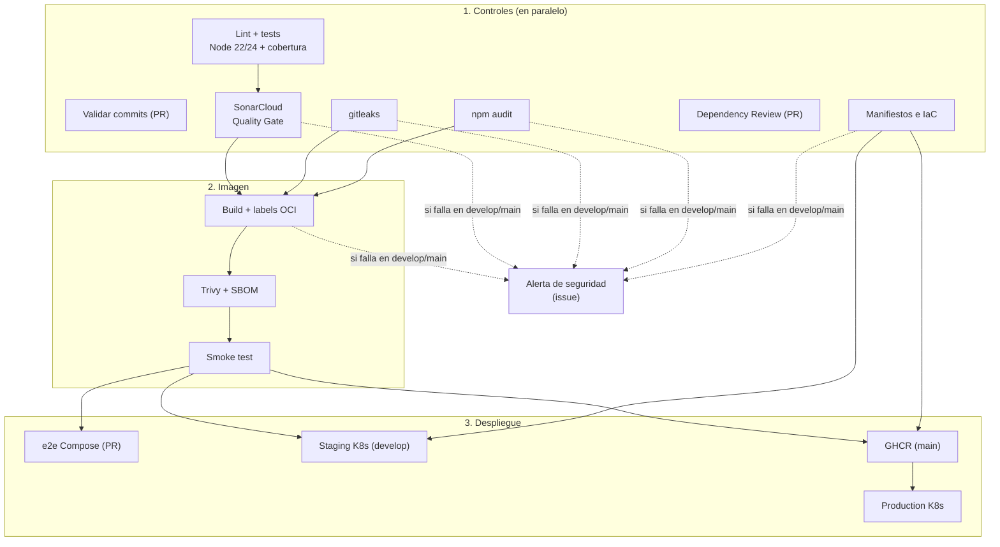

# Pipeline CI/CD con GitHub Actions

Este documento explica cómo está automatizada la integración y el despliegue de `productos-service` y qué rol cumple cada pieza dentro del proceso CI/CD.

## ¿Qué es CI/CD y qué rol cumple GitHub Actions?

- **Integración continua (CI):** cada cambio que se sube al repositorio se compila, analiza y prueba automáticamente, de modo que los errores se detectan minutos después de introducirlos y no al final del sprint.
- **Entrega/Despliegue continuo (CD):** si la integración es exitosa, el artefacto resultante (aquí, una imagen Docker) se despliega automáticamente en un entorno (*staging*) o se publica y despliega en producción.

**GitHub Actions** es el motor de automatización integrado en GitHub. Escucha eventos del repositorio (push, pull request, ejecución manual) y ejecuta *workflows* definidos en YAML dentro de `.github/workflows/`. Cada workflow tiene *jobs* que corren en máquinas virtuales efímeras (*runners*). Esos runners son nuestro **entorno cloud simulado**: infraestructura creada bajo demanda y destruida al terminar, donde levantamos incluso un clúster Kubernetes completo.

Como el pipeline vive en el mismo repositorio que el código, se versiona, se revisa por PR y queda trazado igual que cualquier otro cambio (*pipeline as code*).

## Eventos que disparan el pipeline

Archivo: [`.github/workflows/ci.yml`](../.github/workflows/ci.yml)

| Evento | Rama | Qué se ejecuta |
|--------|------|----------------|
| `pull_request` | hacia `main` o `develop` | Todos los controles de calidad y seguridad, build de la imagen y prueba e2e con Docker Compose |
| `push` | `develop` | Controles, build y **deploy a staging en Kubernetes** |
| `push` | `main` | Controles, build, **publicación en GHCR** y **deploy a production en Kubernetes** |
| `workflow_dispatch` | cualquiera | Ejecución manual; con la opción `desplegar_staging` despliega esa rama en staging |

`concurrency` cancela la ejecución anterior de la misma rama cuando llega un push nuevo, para no gastar minutos en código obsoleto.

## Etapas del pipeline



### 1. Validar convención de commits (solo PR)
Recorre los commits del PR (`git log base..head`) y verifica con una expresión regular que cumplan [Conventional Commits](GUIA-BUENAS-PRACTICAS.md#3-mensajes-de-commit). **Rol:** hacer cumplir automáticamente la convención del equipo, que es la base de la trazabilidad del historial.

### 2. Lint y tests (matriz Node 22 y 24)
- `npm ci`: instala exactamente las versiones del `package-lock.json` (build reproducible).
- `npm run lint`: análisis estático con ESLint.
- `npm run test:ci`: 93 pruebas **unitarias** (`tests/unit/`) e **integración** (`tests/integration/`) con el test runner nativo de Node, con **umbral de cobertura obligatorio** (90% de líneas, 85% de ramas, 90% de funciones). Genera `coverage/lcov.info` (para SonarCloud) y `coverage/junit.xml`.
- Publica en el *Job Summary* el resultado de las pruebas y la tabla de cobertura, y guarda los reportes como artefacto.

**Rol:** es el núcleo de la CI. Garantiza que el código integrado respeta el estilo y no rompe funcionalidad existente, según la política de calidad del proyecto. La matriz verifica la compatibilidad con dos versiones de Node.

### 3. Análisis de código (SonarCloud)
Usa el reporte de cobertura del paso anterior y analiza el código en [SonarCloud](https://sonarcloud.io/summary/new_code?id=BenjaminStavrakopulos_devops-ep1-microservicio): bugs, vulnerabilidades, *security hotspots*, *code smells* y duplicación. Con `sonar.qualitygate.wait=true` el job espera el veredicto del **Quality Gate** y falla si no se aprueba. **Rol:** control de calidad y seguridad del código (SAST) con un criterio objetivo y un historial de métricas por versión.

### 4. Escaneo de secretos (gitleaks)
Ejecuta [gitleaks](https://github.com/gitleaks/gitleaks) sobre **todo el historial** (`fetch-depth: 0`). Si encuentra credenciales, el job falla y muestra el archivo y el commit, con el valor ocultado (`--redact`). **Rol:** evitar que una credencial filtrada llegue a `main`. Se complementa con el *secret scanning* y la *push protection* de GitHub, que rechazan el push.

### 5. Auditoría de dependencias (npm audit)
`npm audit --audit-level=high` falla si alguna dependencia tiene vulnerabilidades conocidas altas o críticas, y `npm audit signatures` verifica la firma de los paquetes descargados del registro. **Rol:** seguridad de la cadena de suministro en cada ejecución, no solo cuando cambian las dependencias.

### 6. Revisión de dependencias del PR (Dependency Review)
Compara las dependencias del PR con las de la rama destino y falla si el PR **agrega** dependencias con vulnerabilidades de severidad *high* o superior, dejando un comentario con el detalle. **Rol:** detener el problema en la revisión, antes de que entre al código.

### 7. Validación de manifiestos e IaC
Renderiza los overlays de Kubernetes con `kustomize build`, los valida contra el esquema de la API (`kubeconform -strict`) y analiza los manifiestos y el Dockerfile con `trivy config`, que **bloquea** configuraciones inseguras HIGH/CRITICAL (contenedores privilegiados, root, sin límites, etc.). **Rol:** tratar la infraestructura como código, con los mismos controles de calidad que la aplicación.

### 8. Build de imagen Docker y smoke test
1. Construye la imagen con build args que se guardan como **labels OCI** (versión, commit, fecha).
2. **Trivy** escanea la imagen: publica el reporte SARIF en *Security → Code scanning* (alertas) y **bloquea** si hay vulnerabilidades HIGH/CRITICAL con parche disponible.
3. Genera un **SBOM** CycloneDX (inventario de componentes) como artefacto.
4. Ejecuta la imagen como **contenedor endurecido** (`--read-only`, `--cap-drop ALL`, `no-new-privileges`, límites de CPU y memoria) y corre las pruebas de humo.
5. Exporta la imagen como artefacto para los despliegues.

**Rol:** validar que el **artefacto desplegable** (no solo el código) es seguro y funciona. Depende de los jobs 2 a 5: si un control falla, no se construye nada.

### 9. Prueba e2e de la orquestación (solo PR)
[`scripts/desplegar-compose.sh`](../scripts/desplegar-compose.sh) levanta el stack de Docker Compose (Nginx + API x3 + PostgreSQL real) con una contraseña efímera, ejecuta las pruebas de humo (incluida la consistencia de datos entre réplicas), escala a 5 réplicas y vuelve a probar. **Rol:** detectar en el PR, antes de mergear, problemas de integración con la base de datos real o de orquestación.

### 10. Deploy a staging en Kubernetes (push a `develop`)
Crea un clúster **kind** de 3 nodos, instala metrics-server, carga la imagen y ejecuta [`scripts/desplegar-k8s.sh`](../scripts/desplegar-k8s.sh) (rollout, smoke test y **rollback automático**) y [`scripts/pruebas-k8s.sh`](../scripts/pruebas-k8s.sh) (balanceo, rolling update sin caída y HPA). Publica el estado del clúster y guarda el manifiesto aplicado. **Rol:** entrega continua a un entorno idéntico a producción, donde se valida cada integración.

### 11. Publicar imagen en GHCR (push a `main`)
Carga **la misma imagen** que pasó los controles (no la reconstruye: *build once, deploy many*), la etiqueta con la versión, `sha-<commit>` y `latest`, la publica en `ghcr.io/benjaminstavrakopulos/productos-service` y entrega su **digest** al job siguiente.

### 12. Deploy a production en Kubernetes
Igual que staging, con el overlay `production` (más réplicas, más recursos, HPA 3–8). La imagen se descarga **desde GHCR por digest**, usando un `imagePullSecret` creado con el token temporal del job. **Rol:** despliegue continuo a producción con una referencia inmutable a la imagen.

### 13. Alerta de seguridad
Si en un push a `develop` o `main` falla SonarCloud, gitleaks, npm audit, la validación de IaC o el build/Trivy, este job abre un **issue** con la etiqueta `seguridad` (o comenta en el existente) con el commit, el enlace a la ejecución y el resultado de cada control. En los PRs, el aviso es el propio check en rojo, que bloquea el merge.

## Dependabot

[`.github/dependabot.yml`](../.github/dependabot.yml) revisa cada lunes:

| Ecosistema | Qué actualiza | Destino |
|------------|---------------|---------|
| `npm` | Dependencias de producción y desarrollo (agrupadas por tipo, solo minor y patch) | PR a `develop` |
| `github-actions` | Versiones de las acciones del workflow | PR a `develop` |
| `docker` | Imagen base `node:22-alpine` | PR a `develop` |

Los PRs de Dependabot usan Conventional Commits (`build(deps): ...`, `ci(deps): ...`) y pasan por los mismos controles que cualquier otro cambio. Las **alertas** y **actualizaciones de seguridad** de Dependabot están activadas en el repositorio: GitHub las abre contra `main`, como un hotfix.

## Manejo de credenciales con GitHub Secrets

| Credencial | Origen | Dónde se usa | Alcance |
|------------|--------|--------------|---------|
| `secrets.GITHUB_TOKEN` | GitHub la crea en cada ejecución y la revoca al terminar | Publicar en GHCR (`packages: write`), descargar en production (`packages: read`), crear issues de alerta (`issues: write`), subir SARIF (`security-events: write`) | Solo este repositorio y solo los permisos declarados en cada job |
| `secrets.SONAR_TOKEN` | Token de análisis de SonarCloud, guardado como secreto del repositorio | Job *Análisis de código* | Solo permite enviar análisis a este proyecto |
| Contraseña de PostgreSQL | Se genera aleatoriamente (`openssl rand`) en cada despliegue y se enmascara con `::add-mask::` | Secret de Kubernetes / variable de Docker Compose | Vive solo mientras dura el entorno |

**Prácticas aplicadas:**

- **Mínimo privilegio:** el workflow declara `permissions: contents: read` a nivel global; cada job agrega solo lo que necesita.
- **Tokens efímeros:** no se usan tokens personales (PAT) de larga duración.
- **Environments:** `staging` y `production` registran cada despliegue y admiten secretos y reglas de aprobación propios.
- **Enmascarado:** GitHub reemplaza por `***` cualquier secreto que aparezca en los logs.
- **PRs desde forks:** no reciben secretos; los despliegues solo corren en `push`.
- **Versiones fijadas** de herramientas (Trivy, kustomize, kubeconform, metrics-server, acciones) para builds reproducibles, actualizadas mediante Dependabot y PRs.

**Cómo agregar un secreto nuevo:** *Settings → Secrets and variables → Actions → New repository secret*, o desde la CLI: `gh secret set NOMBRE`. Se usa en el workflow como `${{ secrets.NOMBRE }}`.

## Cómo ver los resultados

- **Checks del PR:** estado de cada job al final del pull request.
- **Pestaña Actions:** historial, logs por paso, *Job Summary* (pruebas, cobertura, imagen, estado del clúster) y artefactos (reportes, SBOM, imagen, manifiestos).
- **Security:** alertas de Dependabot, de *code scanning* (Trivy) y de *secret scanning*.
- **SonarCloud:** dashboard del proyecto y Quality Gate.
- **Deployments:** historial de `staging` y `production`.
- **Packages:** la imagen publicada en GHCR.

```bash
gh run list                      # últimas ejecuciones
gh run view <id> --log           # logs de una ejecución
gh pr checks <N> --watch         # seguir los checks de un PR
gh run download <id> -n sbom-imagen   # descargar el SBOM de una ejecución
```
