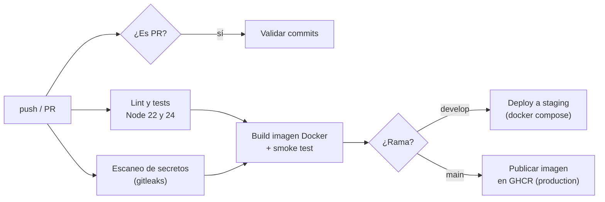

# Pipeline CI/CD con GitHub Actions

Este documento explica cómo está automatizada la integración y el despliegue de `productos-service` y qué rol cumple cada pieza dentro del proceso CI/CD.

## ¿Qué es CI/CD y qué rol cumple GitHub Actions?

- **Integración continua (CI):** cada cambio que se sube al repositorio se compila, analiza y prueba automáticamente, de modo que los errores se detectan minutos después de introducirlos y no al final del sprint.
- **Entrega/Despliegue continuo (CD):** si la integración es exitosa, el artefacto resultante (aquí, una imagen Docker) se despliega automáticamente en un entorno (*staging*) o se publica listo para producción.

**GitHub Actions** es el motor de automatización integrado en GitHub. Escucha eventos del repositorio (push, pull request, tags) y ejecuta *workflows* definidos en YAML dentro de `.github/workflows/`. Cada workflow tiene *jobs* que corren en máquinas virtuales efímeras (*runners*) de GitHub. Esos runners son los que usamos como **entorno cloud simulado**: infraestructura en la nube, creada bajo demanda y destruida al terminar.

Como el pipeline vive en el mismo repositorio que el código, se versiona, se revisa por PR y queda trazado igual que cualquier otro cambio (*pipeline as code*).

## Eventos que disparan el pipeline

Archivo: [`.github/workflows/ci.yml`](../.github/workflows/ci.yml)

| Evento | Rama | Qué se ejecuta |
|--------|------|----------------|
| `pull_request` | hacia `main` o `develop` | Validar commits, escaneo de secretos, lint, tests, build de imagen y smoke test |
| `push` | `develop` | Escaneo de secretos, lint, tests, build, **deploy a staging** |
| `push` | `main` | Escaneo de secretos, lint, tests, build, **publicación de la imagen en GHCR** |
| `workflow_dispatch` | cualquiera | Ejecución manual desde la pestaña *Actions* |

Además, `concurrency` cancela ejecuciones anteriores de la misma rama cuando llega un push nuevo, para no gastar minutos en código obsoleto.

## Etapas del pipeline



### 1. Validar convención de commits (solo en PR)
Recorre los commits del PR (`git log base..head`) y verifica con una expresión regular que cumplan [Conventional Commits](GUIA-BUENAS-PRACTICAS.md#3-mensajes-de-commit). **Rol:** hacer cumplir automáticamente la convención del equipo, sin depender de que el revisor lo note.

### 2. Lint y tests (matriz Node 22 y 24)
- `npm ci`: instala exactamente las versiones del `package-lock.json` (build reproducible).
- `npm run lint`: análisis estático con ESLint (errores comunes, variables sin usar, `==` en vez de `===`).
- `npm run test:coverage`: ejecuta las pruebas con el test runner nativo de Node e informa la cobertura.

**Rol:** es el núcleo de la CI. Garantiza que el código integrado compila, respeta el estilo y no rompe funcionalidad existente. La matriz verifica la compatibilidad con la versión LTS actual y la siguiente.

### 3. Escaneo de secretos (gitleaks)
Ejecuta [gitleaks](https://github.com/gitleaks/gitleaks) sobre **todo el historial** del repositorio (`fetch-depth: 0`). gitleaks trae reglas para cientos de formatos de credenciales: tokens de GitHub, claves de AWS/GCP, cuentas de servicio de Firebase, llaves privadas, cadenas de conexión, etc. Si encuentra alguna, el job falla y muestra el archivo y el commit, con el valor ocultado (`--redact`) para no exponerlo en los logs. **Rol:** seguridad en el pipeline (*DevSecOps*, *shift-left*). Una credencial subida por error se detecta en el PR, antes de llegar a `main`. El build de la imagen depende de este job, así que nada se despliega si hay secretos filtrados.

### 4. Build de imagen Docker y smoke test
Construye la imagen con el `Dockerfile` multi-etapa, levanta un contenedor y ejecuta [`scripts/smoke-test.sh`](../scripts/smoke-test.sh), que llama a los endpoints reales por HTTP. Luego exporta la imagen como artefacto del workflow. **Rol:** validar que el **artefacto desplegable** (no solo el código) funciona. La misma imagen que se probó es la que se despliega en el paso siguiente (*build once, deploy many*).

### 5. Deploy a staging (push a `develop`)
Descarga la imagen construida, la despliega con `docker compose up --wait` (espera a que el healthcheck esté sano) y vuelve a correr las pruebas de humo contra el servicio desplegado. Escribe un resumen con commit, imagen y versión en el *Job Summary*. Usa el *environment* `staging` de GitHub, que deja un historial de despliegues visible en la pestaña *Deployments* del repositorio. **Rol:** entrega continua a un entorno de pruebas que simula la nube, donde se valida cada integración en `develop`.

### 6. Publicar imagen en GHCR (push a `main`)
Construye y publica la imagen en **GitHub Container Registry** (`ghcr.io/benjaminstavrakopulos/productos-service`) con tres etiquetas: la versión del `package.json`, `latest` y el SHA corto del commit. Usa el *environment* `production`. **Rol:** dejar el artefacto de producción versionado y disponible para que cualquier plataforma cloud (Kubernetes, ECS, Cloud Run, etc.) lo despliegue con un `docker pull`.

## Manejo de credenciales con GitHub Secrets

El pipeline necesita autenticarse para publicar la imagen en GHCR. Esa credencial **nunca** se escribe en el código ni en el workflow:

| Credencial | Origen | Dónde se usa | Alcance |
|------------|--------|--------------|---------|
| `secrets.GITHUB_TOKEN` | GitHub la crea automáticamente en cada ejecución y la revoca al terminar | `docker/login-action` en el job *Publicar imagen en GHCR* | Solo este repositorio; permisos definidos en el workflow |

**Prácticas aplicadas en el workflow:**

- **Mínimo privilegio:** a nivel global el workflow declara `permissions: contents: read`. Solo el job de publicación agrega `packages: write`, que es lo único que necesita.
- **Tokens efímeros:** se usa `GITHUB_TOKEN` en vez de un token personal (PAT), así no hay una credencial de larga duración que pueda filtrarse.
- **Environments:** los jobs de despliegue usan los *environments* `staging` y `production`. En GitHub (*Settings → Environments*) se les pueden asignar secretos propios y reglas de protección, como aprobación manual antes de desplegar a producción.
- **Enmascarado:** GitHub reemplaza por `***` cualquier valor de un secreto que aparezca en los logs.
- **PRs desde forks:** GitHub no entrega secretos a workflows disparados por PRs de forks, por eso el deploy solo corre en `push` a `develop`/`main`.
- **Detección:** el job de gitleaks bloquea cualquier credencial que se haya commiteado por error.

**Cómo agregar un secreto nuevo** (por ejemplo, para desplegar en un proveedor cloud):

1. *Settings → Secrets and variables → Actions → New repository secret* (o dentro de un *environment*).
2. Nombre en mayúsculas, por ejemplo `CLOUD_DEPLOY_KEY`, y pegar el valor.
3. Usarlo en el workflow como `${{ secrets.CLOUD_DEPLOY_KEY }}`, normalmente pasado como variable de entorno del paso que lo necesita.
4. Para trabajar en local, las variables van en un archivo `.env`, que está en `.gitignore`.

```bash
gh secret set CLOUD_DEPLOY_KEY --env production < clave.json   # equivalente desde la CLI
```

## Relación con GitFlow

| Rama | Entorno | Artefacto |
|------|---------|-----------|
| `feature/*` (PR) | Runner efímero | Imagen de prueba (no se publica) |
| `develop` | `staging` (simulado con Docker Compose) | Imagen con el SHA del commit |
| `main` | `production` (GHCR) | Imagen `vX.Y.Z` + `latest` |

Así, el modelo de ramas y el pipeline se refuerzan: **nada llega a `main` sin haber pasado por PR, CI y staging**.

## Cómo ver los resultados

- **Checks del PR:** al final de cada pull request aparecen los jobs con su estado.
- **Pestaña Actions:** historial completo de ejecuciones, logs por paso y artefactos.
- **Deployments:** en la página principal del repositorio, sección *Deployments*, con el historial de `staging` y `production`.
- **Packages:** en el perfil/repositorio, la imagen publicada en GHCR.

Desde la terminal:

```bash
gh run list                      # últimas ejecuciones
gh run view <id> --log           # logs de una ejecución
gh pr checks <N> --watch         # seguir los checks de un PR
```

## Ejecutar lo mismo localmente

```bash
npm ci && npm run lint && npm test           # etapa CI
docker compose up -d --build --wait          # "deploy" local
bash scripts/smoke-test.sh                   # pruebas de humo
docker compose down
```
