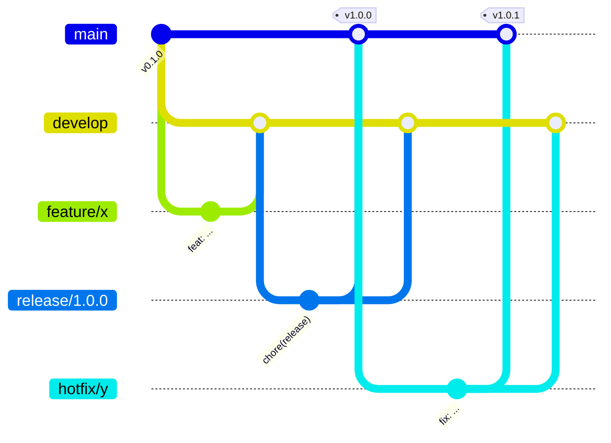

# Guía de buenas prácticas del repositorio

Esta guía define las convenciones obligatorias para trabajar en `productos-service`. Su objetivo es que cualquier integrante (actual o futuro) pueda colaborar sin ambigüedades y que cada cambio sea **trazable** desde el commit hasta el despliegue.

**Contenido**

1. [Modelo de ramificación](#1-modelo-de-ramificación)
2. [Naming de ramas](#2-naming-de-ramas)
3. [Mensajes de commit](#3-mensajes-de-commit)
4. [Pull requests y flujos de merge](#4-pull-requests-y-flujos-de-merge)
5. [Estrategia de revisión de código](#5-estrategia-de-revisión-de-código)
6. [Control de versiones y releases](#6-control-de-versiones-y-releases)
7. [Estructura de carpetas](#7-estructura-de-carpetas)
8. [Protección de ramas](#8-protección-de-ramas)
9. [Qué se versiona y qué no](#9-qué-se-versiona-y-qué-no)
10. [Comandos de referencia](#10-comandos-de-referencia)

---

## 1. Modelo de ramificación

El proyecto usa **GitFlow**. La justificación de esta decisión está en el [README](../README.md#estrategia-de-ramificación).

| Rama | Propósito | Nace de | Se integra en | Vida |
|------|-----------|---------|---------------|------|
| `main` | Código en producción. Cada commit corresponde a una versión etiquetada. | — | — | Permanente |
| `develop` | Integración de funcionalidades para la próxima versión. Se despliega a *staging*. | `main` | — | Permanente |
| `feature/*` | Desarrollo de una funcionalidad o cambio acotado. | `develop` | `develop` | Temporal |
| `release/*` | Preparación de una versión: ajuste de versión, CHANGELOG, correcciones menores. | `develop` | `main` **y** `develop` | Temporal |
| `hotfix/*` | Corrección urgente de un error en producción. | `main` | `main` **y** `develop` | Temporal |



**Reglas:**

- Nunca se hace commit directo a `main` ni a `develop`; todo entra por pull request.
- Una rama `feature/*` resuelve **una sola cosa**. Si crece demasiado, se divide.
- Antes de abrir un PR, la rama se actualiza con su rama base (`git pull origin develop` o `git rebase develop`).
- Las ramas de este repositorio **no se borran** después del merge, para dejar evidencia del flujo (en un proyecto real se eliminarían para mantener el repositorio limpio).

## 2. Naming de ramas

Formato: `<tipo>/<descripcion-corta>`

- Todo en **minúsculas**, palabras separadas por **guiones** (`kebab-case`).
- Sin tildes, ñ, espacios ni caracteres especiales.
- Descripción breve (2 a 4 palabras) que diga **qué** cambia, no quién lo hace.
- Si existe un issue asociado, se puede anteponer su número: `feature/12-filtros-busqueda`.

| Tipo | Uso | Ejemplo |
|------|-----|---------|
| `feature/` | Nueva funcionalidad o mejora | `feature/crud-productos` |
| `release/` | Preparación de versión (SemVer) | `release/1.0.0` |
| `hotfix/` | Corrección urgente sobre producción | `hotfix/eliminar-producto-inexistente` |

| ✅ Correcto | ❌ Incorrecto | Problema |
|------------|--------------|----------|
| `feature/filtros-busqueda` | `Feature/FiltrosBusqueda` | Mayúsculas, sin guiones |
| `hotfix/precio-negativo` | `fix-benja` | Sin tipo, usa nombre de persona |
| `release/1.1.0` | `release/v1.1` | La versión debe ser SemVer completa sin `v` |
| `feature/pipeline-ci` | `feature/cambios` | Descripción no informativa |

## 3. Mensajes de commit

Se usa la especificación [Conventional Commits 1.0.0](https://www.conventionalcommits.org/es/v1.0.0/). **El pipeline valida el formato en cada pull request** (job `Validar convención de commits`) y falla si algún commit no la cumple.

```
<tipo>(<ámbito opcional>): <descripción en imperativo>

[cuerpo opcional: qué y por qué, no cómo]

[footer opcional: BREAKING CHANGE: ..., Refs: #12]
```

| Tipo | Cuándo usarlo | Impacto en SemVer |
|------|---------------|-------------------|
| `feat` | Nueva funcionalidad | MINOR |
| `fix` | Corrección de un error | PATCH |
| `docs` | Solo documentación | — |
| `test` | Agregar o corregir pruebas | — |
| `refactor` | Cambio de código que no altera el comportamiento | — |
| `perf` | Mejora de rendimiento | PATCH |
| `style` | Formato, espacios, punto y coma (sin cambio de lógica) | — |
| `build` | Dependencias, Docker, scripts de build | — |
| `ci` | Configuración del pipeline | — |
| `chore` | Tareas de mantenimiento (versión, configuración) | — |
| `revert` | Revierte un commit anterior | — |

Un `!` después del tipo (`feat!:`) o un footer `BREAKING CHANGE:` indica un cambio incompatible, que implica subir la versión **MAJOR**.

**Reglas de redacción:**

- Descripción en **imperativo** y en minúscula: "agregar filtro", no "agregué filtro" ni "Agregando filtro".
- Máximo ~72 caracteres en la primera línea, sin punto final.
- El ámbito indica el módulo afectado: `productos`, `readme`, `ci`, `docker`, `release`.
- **Commits atómicos:** un commit = un cambio lógico. El código, sus pruebas y su documentación pueden ir en commits separados dentro de la misma rama.

| ✅ Correcto | ❌ Incorrecto |
|------------|--------------|
| `feat(productos): agregar filtro por categoría` | `cambios` |
| `fix(productos): responder 404 al eliminar un id inexistente` | `arreglé el bug` |
| `ci: agregar pipeline de GitHub Actions para develop y main` | `Update ci.yml` |
| `docs(readme): documentar endpoints` | `feat: README` (tipo incorrecto) |

## 4. Pull requests y flujos de merge

Todo cambio entra mediante un **pull request** que usa la [plantilla del repositorio](../.github/pull_request_template.md).

| Origen → Destino | Tipo de merge | Requisitos |
|------------------|---------------|------------|
| `feature/*` → `develop` | Merge commit (`--no-ff`) | CI en verde + revisión |
| `release/*` → `main` | Merge commit (`--no-ff`) + tag `vX.Y.Z` | CI en verde + revisión |
| `release/*` → `develop` | Merge commit (back-merge) | CI en verde |
| `hotfix/*` → `main` | Merge commit (`--no-ff`) + tag `vX.Y.Z` | CI en verde + revisión |
| `hotfix/*` → `develop` | Merge commit (back-merge) | CI en verde |

**¿Por qué merge commit y no squash o rebase?** El merge commit conserva los commits atómicos de la rama **y** deja un commit que marca exactamente cuándo y mediante qué PR (`Merge pull request #N`) se integró el cambio. Así el historial muestra el flujo GitFlow completo (`git log --graph`) y cada línea de código se puede rastrear hasta su PR.

**Título del PR:** sigue el mismo formato de Conventional Commits, por ejemplo `feat(productos): filtros y ordenamiento en el listado`.

**Descripción del PR:** qué cambia y por qué, tipo de cambio, cómo probarlo y checklist completo.

**Tamaño:** se recomienda que un PR tenga menos de ~400 líneas modificadas. Los PRs grandes se revisan peor.

## 5. Estrategia de revisión de código

1. **Automática primero:** el PR no se revisa hasta que el pipeline está en verde (lint, tests en Node 22/24, build de imagen y smoke tests, convención de commits).
2. **Revisión humana:** al menos **1 aprobación** de un integrante distinto al autor (definido en [`CODEOWNERS`](../.github/CODEOWNERS)).
3. **Qué revisa el revisor:**
   - [ ] El cambio hace lo que dice el PR y nada más.
   - [ ] Hay pruebas para la lógica nueva o corregida.
   - [ ] No hay secretos, credenciales ni datos sensibles en el código.
   - [ ] Los nombres son claros y el código sigue el estilo del proyecto (ESLint).
   - [ ] La documentación (README, docs) se actualizó si cambió el comportamiento.
4. **Comentarios:** se usan *suggestions* de GitHub para cambios concretos. Se prefijan los comentarios no bloqueantes con `nit:`.
5. **Resolución:** el autor responde o aplica cada comentario; el revisor resuelve la conversación y aprueba.
6. **Merge:** lo hace el autor una vez aprobado, usando el tipo de merge de la sección 4.

> **Nota sobre este proyecto:** el encargo se desarrolló de forma **individual**, por lo que el autor también actuó como revisor. GitHub no permite aprobar un PR propio, así que la revisión quedó registrada mediante el checklist de cada PR y la validación automática del pipeline. En un equipo, la regla de protección exigiría 1 aprobación obligatoria.

## 6. Control de versiones y releases

- Se usa **[Versionado Semántico 2.0.0](https://semver.org/lang/es/)**: `MAJOR.MINOR.PATCH`.
  - **MAJOR:** cambios incompatibles en la API.
  - **MINOR:** funcionalidad nueva compatible (`feat`).
  - **PATCH:** correcciones compatibles (`fix`, hotfix).
- La versión vive en `package.json` y se expone en `GET /health`, de modo que siempre se puede saber qué versión está desplegada.
- Cada merge a `main` se **etiqueta** con un tag anotado `vX.Y.Z` y se publica un **GitHub Release**.
- Los cambios de cada versión se registran en [`CHANGELOG.md`](../CHANGELOG.md) siguiendo el formato [Keep a Changelog](https://keepachangelog.com/es-ES/1.1.0/).
- La imagen Docker publicada en GHCR se etiqueta con la versión, `latest` y el SHA del commit, lo que permite trazar qué código exacto corre en cada contenedor.

**Proceso de release:**

```bash
git switch develop && git pull
git switch -c release/1.1.0
npm version 1.1.0 --no-git-tag-version      # actualiza package.json y package-lock.json
# actualizar CHANGELOG.md
git commit -am "chore(release): preparar versión 1.1.0"
git push -u origin release/1.1.0
# PR release/1.1.0 -> main, merge, y luego:
git switch main && git pull
git tag -a v1.1.0 -m "Versión 1.1.0" && git push origin v1.1.0
# PR release/1.1.0 -> develop (back-merge)
```

## 7. Estructura de carpetas

```
productos-service/
├── .github/
│   ├── workflows/ci.yml          # Pipeline CI/CD (GitHub Actions)
│   ├── pull_request_template.md  # Plantilla obligatoria de PR
│   └── CODEOWNERS                # Revisores por defecto
├── docs/                         # Documentación técnica del proyecto
├── scripts/
│   └── smoke-test.sh             # Pruebas de humo post-despliegue
├── src/
│   ├── app.js                    # Configuración de Express (middlewares, rutas, errores)
│   ├── server.js                 # Punto de entrada: levanta el servidor
│   ├── routes/                   # Definición de endpoints HTTP
│   ├── data/                     # Acceso a datos (repositorios)
│   ├── validators/               # Validación de entradas
│   └── filtros/                  # Lógica de filtrado y ordenamiento
├── tests/                        # Pruebas automatizadas (*.test.js)
├── Dockerfile                    # Imagen de producción
├── docker-compose.yml            # Entorno cloud simulado
├── CHANGELOG.md                  # Historial de versiones
└── README.md
```

**Convenciones:**

- Archivos de código en `camelCase.js`; documentación en `MAYUSCULAS.md` o `kebab-case.md`.
- Cada capa tiene una sola responsabilidad: las rutas no acceden directo a los datos sin pasar por el repositorio, y la validación no vive en las rutas.
- Las pruebas reflejan el módulo que prueban: `tests/<modulo>.test.js`.
- La configuración del entorno se toma de variables de entorno (`PORT`), nunca se escribe en el código.

## 8. Protección de ramas

Configuración aplicada en GitHub (*Settings → Branches*):

| Regla | `main` | `develop` |
|-------|:------:|:---------:|
| Requerir pull request antes de mergear | ✅ | ✅ |
| Requerir que el CI pase (`Lint y tests`, `Build de imagen`) | ✅ | ✅ |
| Requerir rama actualizada antes de mergear | ✅ | — |
| Bloquear force push y eliminación | ✅ | ✅ |
| Requerir 1 aprobación *(solo en equipo)* | ✅ | ✅ |

## 9. Qué se versiona y qué no

**Sí se versiona:** código fuente, pruebas, `package-lock.json` (garantiza builds reproducibles con `npm ci`), Dockerfile, workflows y documentación.

**No se versiona** (ver [`.gitignore`](../.gitignore)): `node_modules/`, reportes de cobertura, logs, archivos `.env` con secretos y configuraciones personales del IDE.

**Secretos:** nunca se escriben en el código. En el pipeline se usan *GitHub Secrets* (por ejemplo, `secrets.GITHUB_TOKEN` para publicar en GHCR).

**Finales de línea:** `.gitattributes` fuerza `LF` para evitar diferencias entre Windows y los runners Linux.

## 10. Comandos de referencia

| Acción | Comando |
|--------|---------|
| Clonar el repositorio | `git clone https://github.com/BenjaminStavrakopulos/devops-ep1-microservicio.git` |
| Actualizar rama local | `git switch develop && git pull` |
| Crear rama de trabajo | `git switch -c feature/mi-cambio` |
| Ver cambios | `git status` / `git diff` |
| Preparar y confirmar | `git add <archivos>` → `git commit -m "feat(ambito): descripcion"` |
| Publicar rama | `git push -u origin feature/mi-cambio` |
| Abrir PR (CLI) | `gh pr create --base develop --fill` |
| Ver estado del CI | `gh pr checks --watch` |
| Mergear PR | `gh pr merge <N> --merge` |
| Traer cambios de develop a mi rama | `git pull origin develop` |
| Etiquetar versión | `git tag -a v1.0.0 -m "Versión 1.0.0"` → `git push origin v1.0.0` |
| Ver historial gráfico | `git log --oneline --graph --all` |
| Saber quién cambió una línea | `git blame src/routes/productos.js` |
